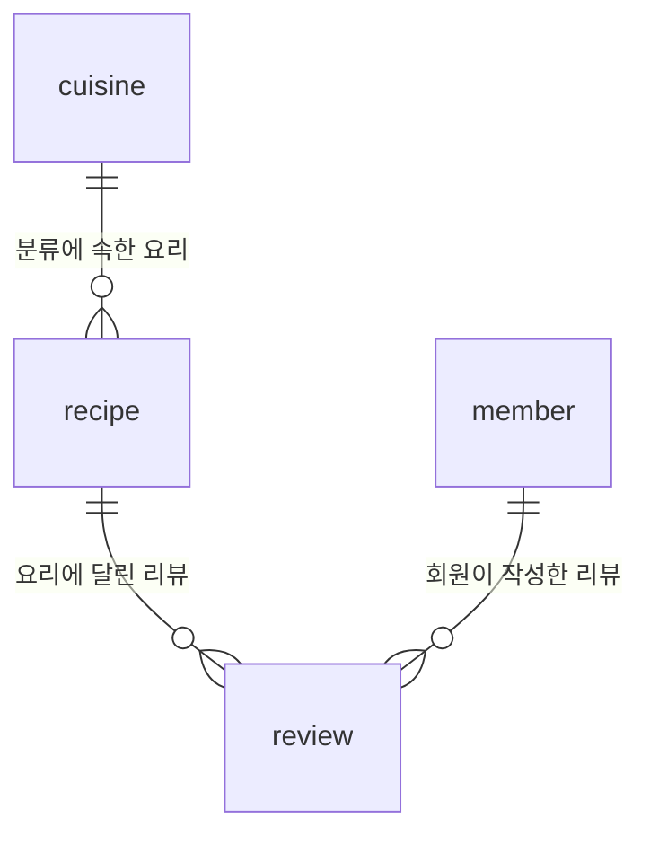

# 요리 리뷰 데이터베이스 과제

한식·일식·양식 등의 요리를 등록하고, 회원이 요리에 평점과 후기를 남기는 작은 데이터베이스입니다. SQLite와 SQL만 사용하며 백엔드 프레임워크는 사용하지 않습니다. 데이터는 모두 실습용 가상 데이터입니다.

## 1. 파일 안내

| 파일 | 역할 |
| --- | --- |
| `schema.sql` | 테이블 4개와 PK, FK, 제약조건 생성 |
| `seed.sql` | 분류 10개, 요리 20개, 회원 10명, 리뷰 20개 입력 |
| `queries.sql` | 설명이 붙은 핵심 SQL 15개 |
| `results/Q01.txt` ~ `Q15.txt` | 실제 SQL과 실행 결과 텍스트 |
| `results/validation.txt` | 데이터 개수와 제약조건 확인 결과 |
| `run_assignment.py` | SQL 실행 및 결과 텍스트 재생성 도우미 |

제출할 때는 SQL 파일 3개와 `results` 폴더를 함께 제출하면 됩니다. Python은 결과 기록을 돕는 도구이며, 과제의 DB 작업은 SQL 파일에 들어 있습니다.

## 2. 실행 방법

### 가장 간단하게 전체 결과 확인하기

이 폴더에서 아래 명령을 실행합니다. Python 3의 기본 라이브러리만 사용하므로 추가 패키지가 필요하지 않습니다.

```sh
python3 run_assignment.py
```

메모리에 새 DB를 만들고 15개 쿼리의 결과를 `results` 폴더에 기록합니다. 실행이 끝나면 메모리 DB는 사라집니다. 반복 실행해도 샘플 데이터가 중복되지 않습니다.

### SQLite CLI로 직접 실습하기

터미널에서 이 폴더로 이동한 뒤 실행합니다. `cooking.db`는 아직 만들지 않은 새 파일 이름이어야 합니다.

```sh
sqlite3 cooking.db
```

SQLite 프롬프트에서 한 줄씩 입력합니다. 점으로 시작하는 명령은 SQLite CLI 전용입니다.

```sql
.bail on
.headers on
.mode column
.read schema.sql
.read seed.sql
.read queries.sql
```

요리를 직접 조회해 봅니다.

```sql
SELECT * FROM recipe;
.quit
```

이미 만든 DB를 다시 열 때는 `schema.sql`, `seed.sql`을 다시 실행하지 않습니다. 새 연결에서는 `PRAGMA foreign_keys = ON;`을 먼저 실행하세요. 처음부터 다시 실습하려면 `sqlite3 cooking_practice2.db`처럼 다른 새 파일을 사용합니다.

## 3. 테이블을 이렇게 나눈 이유

엑셀에서도 여러 시트로 데이터를 나눌 수 있습니다. DB는 여기에 **키와 제약조건으로 연결 규칙을 검사하고, SQL로 여러 테이블을 함께 조회하는 기능**을 제공합니다. 한 표에 모든 내용을 넣으면 리뷰마다 분류 설명과 회원 이메일을 반복해서 적어야 합니다. 이를 나누면 같은 정보를 한곳에서 관리할 수 있습니다.

분류 테이블도 최소 10행이어야 하므로 한식·일식·양식 외에 중식, 태국식, 베트남식, 인도식, 멕시코식, 튀르키예식, 그리스식을 넣었습니다. 이 실습에서 양식은 유럽·미국 계열의 포괄적인 분류이며, 그리스 요리는 별도 분류로 등록합니다. 각 요리는 한 분류에만 속하도록 단순화했습니다.



예를 들어 `cuisine`의 1번은 한식입니다. `recipe`의 김치볶음밥은 `cuisine_id = 1`을 저장하여 한식을 가리킵니다. `review`는 요리 번호와 회원 번호를 함께 저장하여 누가 어떤 요리를 평가했는지 연결합니다.

| 테이블 | 컬럼과 의미 |
| --- | --- |
| `cuisine` | `cuisine_id`: 분류 번호, `name`: 분류 이름, `description`: 설명 |
| `recipe` | `recipe_id`: 요리 번호, `cuisine_id`: 분류 번호, `name`: 요리 이름, `main_ingredient`: 주재료, `cooking_minutes`: 조리 시간(분), `difficulty`: 난이도 |
| `member` | `member_id`: 회원 번호, `nickname`: 닉네임, `email`: 이메일 |
| `review` | `review_id`: 리뷰 번호, `recipe_id`: 요리 번호, `member_id`: 작성자 번호, `rating`: 1~5점 평점, `comment`: 후기, `created_at`: 작성일 |

조리 시간은 재료 손질 등을 포함하는 실습용 가정값입니다. 날짜는 SQLite에서 다루기 쉬운 `YYYY-MM-DD` 형식의 TEXT이며, 현재 스키마가 날짜 형식까지 검사하지는 않습니다.

## 4. 꼭 알아둘 용어

- **PK(기본 키)**: 한 행을 구별하는 고유 번호입니다. 동명이인이 있어도 회원 번호로 구별할 수 있습니다.
- **FK(외래 키)**: 다른 테이블의 번호를 가리킵니다. 존재하지 않는 요리 번호로 리뷰를 쓰면 오류가 납니다.
- **1:N 관계**: 분류 하나에 요리 여러 개, 요리 하나에 리뷰 여러 개, 회원 한 명에 리뷰 여러 개가 연결됩니다.
- **NOT NULL**: 반드시 값을 입력해야 합니다. 다만 빈 문자열까지 막는 조건은 아닙니다.
- **UNIQUE**: 중복을 막습니다. 닉네임과 이메일은 중복될 수 없습니다. `UNIQUE(recipe_id, member_id)`는 한 회원이 같은 요리에 리뷰를 두 번 남기는 것을 막습니다.
- **CHECK**: 평점 1~5, 조리 시간 1분 이상, 정해진 난이도처럼 값의 범위를 검사합니다.

부모 데이터를 먼저 넣어야 하므로 분류 → 요리, 회원 → 리뷰 순서를 지킵니다. 리뷰가 참조 중인 요리나 회원을 바로 삭제하는 것도 FK가 막습니다. 삭제가 필요하면 관련 리뷰를 먼저 처리해야 합니다.

## 5. SQL 15개 학습 안내

| 번호 | 분류 | 확인하는 내용 |
| --- | --- | --- |
| Q01 | 기본 조회 | 전체 요리 목록 |
| Q02 | WHERE | 20분 이내 요리 |
| Q03 | ORDER BY, LIMIT | 쉬우면서 빨리 만드는 요리 5개 |
| Q04 | LIKE | 이름에 파스타가 들어간 요리 |
| Q05 | INNER JOIN | 요리와 분류 연결 |
| Q06 | INNER JOIN | 리뷰와 작성자, 요리 연결 |
| Q07 | LEFT JOIN | 리뷰 없는 요리도 포함 |
| Q08 | LEFT JOIN | 리뷰 없는 회원 찾기 |
| Q09 | GROUP BY, COUNT | 분류별 요리 개수 |
| Q10 | GROUP BY, COUNT, AVG | 요리별 리뷰 수와 평균 평점 |
| Q11 | GROUP BY, AVG, SUM | 분류별 평균 조리 시간과 시간 합계 |
| Q12 | 서브쿼리 | 전체 평균보다 오래 걸리는 요리 |
| Q13 | UPDATE | 조리 시간 수정 및 확인 |
| Q14 | DELETE | 리뷰 삭제 및 확인 |
| Q15 | CREATE INDEX | 회원 번호 검색용 인덱스 생성 및 검색 계획 확인 |

`SELECT`는 읽기, `INSERT`는 추가, `UPDATE`는 수정, `DELETE`는 삭제입니다. `UPDATE`나 `DELETE`에 `WHERE`를 생략하면 모든 행에 적용되므로 조건을 먼저 확인해야 합니다.

`JOIN ... ON`은 서로 같은 번호를 가진 데이터를 연결합니다. `INNER JOIN`은 연결된 데이터만 남기고, `LEFT JOIN`은 왼쪽 데이터를 모두 남깁니다. 연결된 리뷰가 없으면 리뷰 쪽 값이 `NULL`로 표시됩니다. Q07에서는 케밥과 그리스샐러드가 이런 경우이며, Q08에서는 새내기 회원이 조회됩니다.

`GROUP BY`는 같은 값끼리 묶습니다. 묶은 뒤 `COUNT`는 개수, `AVG`는 평균, `SUM`은 합계를 구합니다. Q10에서 `COUNT(v.review_id)`를 쓰면 리뷰 없는 요리의 리뷰 수가 0이 됩니다. `COUNT(*)`를 쓰면 LEFT JOIN으로 남은 행까지 세어서 1이 될 수 있습니다. 리뷰 없는 요리의 평균은 0점이 아닌 `NULL`, 즉 아직 평가가 없다는 뜻입니다.

Q12의 괄호 안 SELECT가 먼저 전체 평균 조리 시간인 23분을 구하고, 바깥 SELECT가 23분보다 오래 걸리는 요리를 고릅니다. Q11의 시간 합계는 각 요리를 한 번씩 순서대로 만들 때의 가정값입니다.

Q13과 Q14는 `BEGIN TRANSACTION`으로 변경을 시작하고, `SELECT`로 결과를 확인한 뒤 `ROLLBACK`으로 되돌립니다. 따라서 출력에서는 18분과 리뷰 19개가 보이지만, 실습 후에는 원래 15분과 리뷰 20개가 유지됩니다. 실제 변경을 저장하는 실습에서는 해당 `ROLLBACK`을 `COMMIT`으로 바꿀 수 있습니다.

인덱스는 책의 찾아보기처럼 검색을 돕는 구조입니다. 회원별 리뷰 조회를 위해 `review.member_id`에 만들었습니다. 요리 번호는 기존 복합 UNIQUE 인덱스의 첫 컬럼이라 이미 검색에 활용할 수 있습니다. 인덱스에는 저장 공간과 입력·수정 비용도 필요하며, 데이터가 적은 이번 실습에서 속도 차이가 크게 나지는 않습니다. Q15는 SQLite 전용 `EXPLAIN QUERY PLAN`으로 검색 계획을 보여 줍니다.

## 6. 결과 확인과 요구사항 충족

`results`의 텍스트는 예측해서 쓴 값이 아니라 제공한 SQL을 실제 실행한 결과입니다. 각 파일에서 실행 SQL, 컬럼 이름, 결과 행과 행 수를 확인할 수 있습니다. `NULL`은 값이 없음을 뜻합니다. Python에 포함된 SQLite와 CLI SQLite의 버전에 따라 검색 계획의 표현은 달라질 수 있습니다.

| 요구사항 | 구현 |
| --- | --- |
| 로컬 DB, 프레임워크 없이 실행 | SQLite, SQL 파일 3개 |
| 최소 4개 테이블, 각 10행 이상 | 4개 테이블, 총 60행 |
| PK, 최소 2개 FK 및 1:N 관계 | 모든 테이블 PK, FK 3개 |
| NOT NULL, UNIQUE, FK 동작 | 스키마 및 `validation.txt` |
| 기본 조회 4개 이상 | Q01~Q04 |
| 조인 4개 이상 | Q05~Q08, INNER JOIN 2개 및 LEFT JOIN 2개 |
| 집계 3개 이상 | Q09~Q11 |
| 서브쿼리 1개 이상 | Q12 |
| 수정 및 삭제 2개 이상 | Q13~Q14 |
| 인덱스 1개 이상과 이유 | Q15 및 주석 |
| 쿼리별 설명과 실행 결과 | SQL 주석 및 `results/Q01.txt`~`Q15.txt` |

제약조건 확인에서는 없는 요리 참조, 닉네임 중복, 필수 이름 누락, 평점 범위 위반 입력이 실제로 거부되는지 확인합니다. 없는 요리 오류를 고치려면 먼저 그 요리를 등록하거나, 이미 존재하는 요리 번호를 사용해야 합니다.
