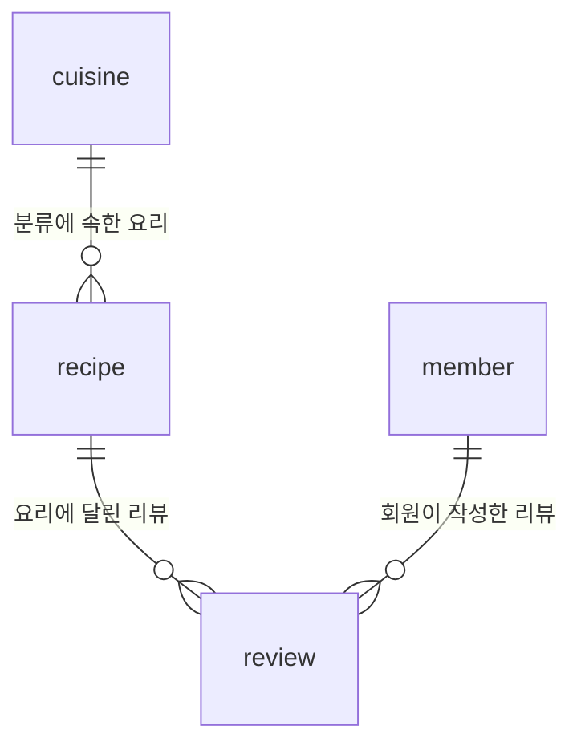

# 요리 리뷰 데이터베이스 과제

한식, 일식, 양식 같은 요리를 주제로 DB를 구성했습니다. 요리마다 분류와 조리 시간을 저장하고, 회원이 평점과 후기를 남길 수 있는 구조입니다.

별도 서버 없이 실행할 수 있는 SQLite를 사용했습니다. 요리 정보와 회원, 리뷰 데이터는 모두 과제 실습용으로 만들었습니다.

## 파일 구성

| 파일 | 역할 |
| --- | --- |
| `schema.sql` | 테이블 4개와 PK, FK, 제약조건 생성 |
| `seed.sql` | 분류 10개, 요리 20개, 회원 10명, 리뷰 20개 입력 |
| `queries.sql` | 설명이 붙은 핵심 SQL 15개 |
| `results/Q01.txt` ~ `Q15.txt` | 실제 SQL과 실행 결과 텍스트 |
| `results/validation.txt` | 데이터 개수와 제약조건 확인 결과 |
| `run_assignment.py` | SQL 실행 및 결과 텍스트 재생성 도우미 |

제출 파일은 SQL 파일 3개, `results` 폴더, 이 README입니다. `run_assignment.py`는 SQL을 실행하고 결과를 텍스트로 저장하는 용도로 추가했습니다.

## 실행 방법

### 결과 파일 한 번에 만들기

이 폴더에서 아래 명령을 실행합니다. Python 3의 기본 라이브러리만 사용하므로 추가 패키지가 필요하지 않습니다.

```sh
python3 run_assignment.py
```

메모리에 새 DB를 만들고 15개 쿼리의 결과를 `results` 폴더에 기록합니다. 실행이 끝나면 메모리 DB는 사라집니다. 반복 실행해도 샘플 데이터가 중복되지 않습니다.

### SQLite에서 직접 실행하기

터미널에서 이 폴더로 이동한 뒤 실행합니다. `cooking.db`는 아직 만들지 않은 새 파일 이름이어야 합니다.

```sh
sqlite3 cooking.db
```

SQLite 프롬프트에서 한 줄씩 입력합니다. 점으로 시작하는 명령은 SQLite CLI 전용입니다.

```sql
.bail on
.headers on
.mode column
.read schema.sql
.read seed.sql
.read queries.sql
```

요리를 직접 조회해 봅니다.

```sql
SELECT * FROM recipe;
.quit
```

**이전 스키마로 만든 DB에는 이 변경이 자동 적용되지 않습니다.** 간소화한 구조를 실습하려면 새 DB 파일을 만들고 `schema.sql` → `seed.sql` → `queries.sql` 순서로 실행하세요.

앱에서 `cannot start a transaction within a transaction` 오류가 나면, 이미 트랜잭션이 열린 상태인지 확인해야 합니다. 기존 작업을 저장(Commit)한 뒤 다시 실행하세요. 앱이 자동으로 트랜잭션을 시작하는 경우에는 자동 트랜잭션 설정도 확인해야 합니다.

이미 만든 DB를 다시 열 때는 `schema.sql`, `seed.sql`을 다시 실행하지 않습니다. 새 연결에서는 `PRAGMA foreign_keys = ON;`을 먼저 실행하세요. 처음부터 다시 실습하려면 `sqlite3 cooking_practice2.db`처럼 다른 새 파일을 사용합니다.

## 테이블 구성

테이블은 요리 분류(`cuisine`), 요리(`recipe`), 회원(`member`), 리뷰(`review`)로 나눴습니다.

리뷰 한 행에 요리 이름과 회원 닉네임을 모두 적으면 같은 정보를 계속 반복하게 됩니다. 닉네임이 바뀔 때 여러 리뷰를 수정해야 하는 문제도 생깁니다. 그래서 회원 정보는 회원 테이블에 한 번만 저장하고, 리뷰에는 회원 번호를 넣어 연결했습니다.

엑셀에서도 시트를 나눠 관리할 수 있지만, 이 DB에서는 FK로 존재하지 않는 회원의 리뷰를 막고 UNIQUE로 닉네임 중복을 막습니다. 나눈 데이터는 JOIN으로 함께 조회할 수 있습니다.

처음 주제로 정한 한식·일식·양식 외에도 중식, 태국식 등 분류를 추가해 총 10개를 넣었습니다. 분류 테이블도 최소 10행이라는 과제 조건에 맞춘 구성입니다. 양식은 넓은 범주이지만 이번 데이터에서는 그리스식을 따로 두었고, 요리 하나는 분류 하나에만 속하도록 했습니다.



예를 들어 `cuisine`의 1번은 한식입니다. `recipe`의 김치볶음밥은 `cuisine_id = 1`을 저장하여 한식을 가리킵니다. `review`는 요리 번호와 회원 번호를 함께 저장하여 누가 어떤 요리를 평가했는지 연결합니다.

| 테이블 | 컬럼과 의미 |
| --- | --- |
| `cuisine` | `cuisine_id`: 분류 번호, `name`: 분류 이름 |
| `recipe` | `recipe_id`: 요리 번호, `cuisine_id`: 분류 번호, `name`: 요리 이름, `cooking_minutes`: 조리 시간(분) |
| `member` | `member_id`: 회원 번호, `nickname`: 닉네임 |
| `review` | `review_id`: 리뷰 번호, `recipe_id`: 요리 번호, `member_id`: 작성자 번호, `rating`: 1~5점 평점, `comment`: 후기 |

이름과 후기는 문자열이므로 TEXT, 조리 시간과 평점은 숫자 비교와 평균 계산이 필요하므로 INTEGER로 정했습니다. 조리 시간은 실습용으로 정한 값입니다.

구조를 간단하게 보기 위해 분류 설명, 주재료, 난이도, 이메일, 작성일은 제외했습니다. 요리 하나에 여러 리뷰를 남기는 관계를 익히는 데 집중한 구성입니다.

## 데이터 입력 규칙

각 테이블의 기본 키(PK)는 행을 구분하는 번호입니다. 다른 테이블을 가리키는 외래 키(FK)와는 역할이 다릅니다.

| 테이블 | PK | FK |
| --- | --- | --- |
| `cuisine` | `cuisine_id` | 없음 |
| `recipe` | `recipe_id` | `cuisine_id` |
| `member` | `member_id` | 없음 |
| `review` | `review_id` | `recipe_id`, `member_id` |

한 분류에 여러 요리, 한 요리에 여러 리뷰, 한 회원에게 여러 리뷰가 연결되므로 1:N 관계는 총 세 개입니다. 예를 들어 1번 리뷰는 `recipe_id = 1`인 김치볶음밥과 `member_id = 1`인 밥사랑 회원을 연결합니다.

이름 같은 필수 항목에는 `NOT NULL`을 걸었습니다. 분류 이름과 회원 닉네임은 `UNIQUE`로 중복을 막았습니다. 평점은 1~5점, 조리 시간은 1분 이상이어야 하며 `CHECK`로 검사합니다. 참고로 NOT NULL은 값이 없는 경우를 막지만 빈 문자열까지 막지는 않습니다.

같은 회원이 같은 요리에 여러 번 리뷰를 남기는 것은 허용합니다. 번호(PK)가 다르면 별개의 리뷰로 저장됩니다.

부모 데이터를 먼저 넣어야 하므로 분류 → 요리, 회원 → 리뷰 순서를 지킵니다. 리뷰가 참조 중인 요리나 회원을 바로 삭제하는 것도 FK가 막습니다. 삭제가 필요하면 관련 리뷰를 먼저 처리해야 합니다.

## 작성한 쿼리

| 번호 | 분류 | 확인하는 내용 |
| --- | --- | --- |
| Q01 | 기본 조회 | 전체 요리 목록 |
| Q02 | WHERE | 20분 이내 요리 |
| Q03 | ORDER BY, LIMIT | 20분 이내 요리 중 빠른 순서로 5개 |
| Q04 | LIKE | 이름에 파스타가 들어간 요리 |
| Q05 | INNER JOIN | 요리와 분류 연결 |
| Q06 | INNER JOIN | 리뷰와 작성자, 요리 연결 |
| Q07 | LEFT JOIN | 리뷰 없는 요리도 포함 |
| Q08 | LEFT JOIN | 리뷰 없는 회원 찾기 |
| Q09 | GROUP BY, COUNT | 분류별 요리 개수 |
| Q10 | GROUP BY, COUNT, AVG | 요리별 리뷰 수와 평균 평점 |
| Q11 | GROUP BY, AVG, SUM | 분류별 평균 조리 시간과 시간 합계 |
| Q12 | 서브쿼리 | 전체 평균보다 오래 걸리는 요리 |
| Q13 | UPDATE | 조리 시간 수정 및 확인 |
| Q14 | DELETE | 리뷰 삭제 및 확인 |
| Q15 | CREATE INDEX | 회원 번호 검색용 인덱스 생성 및 검색 계획 확인 |

`SELECT`는 읽기, `INSERT`는 추가, `UPDATE`는 수정, `DELETE`는 삭제입니다. `UPDATE`나 `DELETE`에 `WHERE`를 생략하면 모든 행에 적용되므로 조건을 먼저 확인해야 합니다.

Q05~Q08은 테이블을 연결하는 JOIN 실습입니다. `ON`에는 어떤 컬럼을 기준으로 연결할지 적었습니다. `INNER JOIN`은 연결된 데이터만 남기고, `LEFT JOIN`은 왼쪽 데이터를 모두 남깁니다. 연결된 리뷰가 없으면 리뷰 쪽 값이 `NULL`로 표시됩니다. Q07에서는 케밥과 그리스샐러드가 이런 경우이며, Q08에서는 새내기 회원이 조회됩니다.

`GROUP BY`는 같은 값끼리 묶습니다. 묶은 뒤 `COUNT`는 개수, `AVG`는 평균, `SUM`은 합계를 구합니다. Q10에서 `COUNT(v.review_id)`를 쓰면 리뷰 없는 요리의 리뷰 수가 0이 됩니다. `COUNT(*)`를 쓰면 LEFT JOIN으로 남은 행까지 세어서 1이 될 수 있습니다. 리뷰 없는 요리의 평균은 0점이 아닌 `NULL`, 즉 아직 평가가 없다는 뜻입니다.

Q06은 리뷰 테이블만으로 알 수 없는 작성자와 요리 이름을 가져오는 쿼리입니다. 먼저 리뷰의 `member_id`로 회원을 연결해 닉네임을 가져오고, `recipe_id`로 요리를 연결해 요리 이름을 가져옵니다. 결과에서 1번 리뷰는 밥사랑이 김치볶음밥에 5점을 준 리뷰로 표시됩니다.

Q12는 전체 평균보다 조리 시간이 긴 요리를 찾습니다. 안쪽 SELECT로 평균 23분을 구하고, 바깥 SELECT에서 조리 시간이 그 값보다 큰 행을 남기는 방식입니다. Q11의 시간 합계는 각 요리를 한 번씩 순서대로 만들 때의 가정값입니다.

Q13과 Q14는 `BEGIN TRANSACTION`으로 변경을 시작하고, `SELECT`로 결과를 확인한 뒤 `ROLLBACK`으로 되돌립니다. 따라서 출력에서는 18분과 리뷰 19개가 보이지만, 실습 후에는 원래 15분과 리뷰 20개가 유지됩니다. 실제 변경을 저장하는 실습에서는 해당 `ROLLBACK`을 `COMMIT`으로 바꿀 수 있습니다.

인덱스는 책의 찾아보기처럼 검색을 돕는 구조입니다. 회원별 리뷰 조회를 위해 `review.member_id`에 만들었습니다. Q15를 실행하기 전에는 분류 이름과 닉네임의 UNIQUE 조건에 따른 자동 인덱스만 있으며, FK 선언 자체로는 인덱스가 생성되지 않습니다. 인덱스에는 저장 공간과 입력·수정 비용도 필요하며, 데이터가 적은 이번 실습에서 속도 차이가 크게 나지는 않습니다. Q15는 SQLite 전용 `EXPLAIN QUERY PLAN`으로 검색 계획을 보여 줍니다.

## 실행 결과와 검증

`results/Q01.txt`부터 `Q15.txt`까지 각 쿼리를 실행한 결과를 저장했습니다. 파일 안에는 실행한 SQL과 컬럼 이름, 결과 행과 행 수가 들어 있습니다. `NULL`은 값이 없음을 뜻합니다. Python에 포함된 SQLite와 CLI SQLite의 버전에 따라 검색 계획의 표현은 달라질 수 있습니다.

| 요구사항 | 구현 |
| --- | --- |
| 로컬 DB, 프레임워크 없이 실행 | SQLite, SQL 파일 3개 |
| 최소 4개 테이블, 각 10행 이상 | 4개 테이블, 총 60행 |
| PK, 최소 2개 FK 및 1:N 관계 | 모든 테이블 PK, FK 3개 |
| NOT NULL, UNIQUE, FK 동작 | 스키마 및 `validation.txt` |
| 기본 조회 4개 이상 | Q01~Q04 |
| 조인 4개 이상 | Q05~Q08, INNER JOIN 2개 및 LEFT JOIN 2개 |
| 집계 3개 이상 | Q09~Q11 |
| 서브쿼리 1개 이상 | Q12 |
| 수정 및 삭제 2개 이상 | Q13~Q14 |
| 인덱스 1개 이상과 이유 | Q15 및 주석 |
| 쿼리별 설명과 실행 결과 | SQL 주석 및 `results/Q01.txt`~`Q15.txt` |

`validation.txt`에는 테이블별 데이터 개수와 제약조건 검사 결과를 남겼습니다. 존재하지 않는 요리 번호 999로 리뷰를 넣는 경우, 닉네임이 중복되는 경우, 필수 이름이 빠진 경우, 평점이 6인 경우를 각각 시도했고 모두 거부됐습니다.

요리 번호 999를 참조한 입력은 `FOREIGN KEY constraint failed` 오류가 납니다. 리뷰가 가리킬 요리가 없기 때문입니다. 이런 경우에는 요리를 먼저 등록하거나 이미 등록된 요리 번호를 사용해야 합니다.
